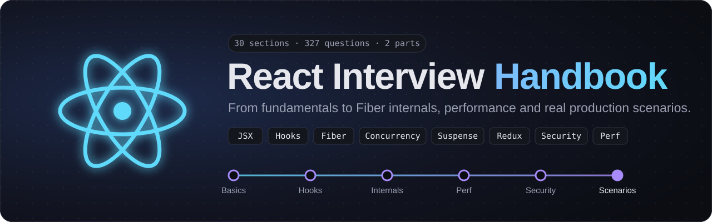

<p align="center">
  <a href="https://react-interview-handbook.vercel.app">
    
  </a>
</p>

<p align="center">
  <a href="https://react-interview-handbook.vercel.app"></a>
</p>

<p align="center">
  
  
  
  
  
  <a href="LICENSE"></a>
  <a href="CONTRIBUTING.md"></a>
</p>

<p align="center">
  <b>300+ React interview questions answered in plain English, with code.</b><br>
  From fundamentals to Fiber internals, performance and real production scenarios.
</p>

---

## ✨ Why this handbook

Most React interview lists give you questions. This one gives you **answers you can actually say out loud**.

Every question page has the same shape:

| Part | What you get |
|---|---|
| **Short answer** | 2-4 sentences to open your reply in the interview |
| **Explanation** | The deeper "why", with analogies, tables and ASCII diagrams |
| **Example** | Small, correct React 19 code |
| **Common mistakes** | The traps interviewers listen for |
| **Follow-up questions** | What they'll ask next, with short answers |
| **Quick recap** | One-line bullets to revise before the interview |

Scenario questions ("Your app is slow after a release, what do you do?") follow a **Why it happens → How to fix it → How to verify** structure instead.

## 🌐 Features

- 🔎 **Instant search** across every question (press <kbd>/</kbd>)
- 🧭 **Sidebar by section**, "On this page" menu and previous/next links
- 🌗 **Auto, light and dark themes**
- 📱 **Responsive** on phones, tablets and wide screens
- 📲 **Installable PWA** that serves visited pages offline
- 🚀 **SEO-ready**: per-page meta tags, Open Graph cards, structured data, sitemap
- ✍️ **Plain Markdown content**: add a question by adding a file, no code changes

## 📚 What's inside

### Part 1: Question Bank

| # | Section | Questions |
|---|---|---:|
| 01 | [React Fundamentals](content/01-react-fundamentals) | 32 |
| 02 | [State & Props](content/02-state-and-props) | 9 |
| 03 | [Component Types & Patterns](content/03-component-types-and-patterns) | 12 |
| 04 | [Events](content/04-events) | 17 |
| 05 | [React Lifecycle & Hooks](content/05-lifecycle-and-hooks) | 13 |
| 06 | [State Management](content/06-state-management) | 15 |
| 07 | [Internals: Fiber & Reconciliation](content/07-fiber-and-reconciliation) | 15 |
| 08 | [Internals: Virtual DOM vs Real DOM](content/08-virtual-dom-vs-real-dom) | 10 |
| 09 | [Internals: Rendering, Batching & Concurrency](content/09-rendering-batching-concurrency) | 10 |
| 10 | [Internals: React 18 Concurrent Features](content/10-react-18-concurrent-features) | 16 |
| 11 | [Internals: Suspense](content/11-suspense-internals) | 10 |
| 12 | [Performance & Optimization](content/12-performance-optimization) | 4 |
| 13 | [React + Redux](content/13-react-redux) | 12 |
| 14 | [Security in React](content/14-security-in-react) | 10 |
| 15 | [API, Async Handling & Networking](content/15-api-async-networking) | 9 |
| 16 | [Security & Best Practices](content/16-security-best-practices) | 4 |
| 17 | [React Advanced: Application Behavior](content/17-app-behavior-scenarios) | 7 |
| 18 | [Browser, Rendering & Web Fundamentals](content/18-browser-rendering-web-fundamentals) | 9 |
| 19 | [SPA, Architecture & System Design](content/19-spa-architecture-system-design) | 12 |
| 20 | [SPA Behavior & Browser Mechanics](content/20-spa-behavior-browser-mechanics) | 8 |
| 21 | [Advanced Async & Practical Edge Cases](content/21-advanced-async-edge-cases) | 3 |

### Part 2: Scenario-Based

| # | Section | Questions |
|---|---|---:|
| 22 | [Rendering & Batching](content/22-scenario-rendering-and-batching) | 5 |
| 23 | [Effects & Stale Closures](content/23-scenario-effects-and-stale-closures) | 7 |
| 24 | [Memoization & Re-renders](content/24-scenario-memoization-and-rerenders) | 9 |
| 25 | [DOM, Reconciliation & Keys](content/25-scenario-dom-reconciliation-and-keys) | 8 |
| 26 | [Concurrent Features & Suspense](content/26-scenario-concurrent-and-suspense) | 11 |
| 27 | [Production & Debugging](content/27-scenario-production-debugging) | 12 |
| 28 | [Performance Debugging](content/28-scenario-performance-debugging) | 10 |
| 29 | [Scalability, Bundles & Metrics](content/29-scenario-scalability-bundles-metrics) | 11 |

## 🚀 Run it locally

Requires **Node.js 20.9+**.

```bash
git clone https://github.com/Ashukr321/react-interview-handbook.git
cd react-interview-handbook
npm install
npm run dev
```

Open http://localhost:3000.

| Command | What it does |
|---|---|
| `npm run dev` | Start the dev server |
| `npm run build` | Build every page as static HTML |
| `npm run start` | Serve the production build |
| `npm run lint` | Run ESLint |

## 🗂️ Project structure

```text
content/                          ← all questions live here (Markdown)
  07-fiber-and-reconciliation/
    index.md                      ← section title, order, part, description
    01-what-is-react-fiber.md     ← one file per question
src/
  app/                            ← Next.js App Router pages, sitemap, manifest, OG image
  components/                     ← Sidebar, Search, Markdown, ThemeToggle, PwaRegister
  lib/content.ts                  ← reads content/ and builds sections, topics, search index
  lib/site.ts                     ← site name, URL and description used for SEO
public/
  sw.js                           ← service worker (offline support)
  icons/                          ← PWA icons
resources/                        ← the original question-bank PDFs
```

## 🛠️ Tech stack

[Next.js 16](https://nextjs.org) (App Router, static generation) · [React 19](https://react.dev) · TypeScript · Tailwind CSS 4 · [react-markdown](https://github.com/remarkjs/react-markdown) with remark-gfm, rehype-slug and rehype-highlight · gray-matter · deployed on [Vercel](https://vercel.com)

## 🤝 Contributing

Contributions are welcome: fix an answer, add a question, improve an example or polish the UI.

1. Read the **[contribution guide](CONTRIBUTING.md)** (content format, writing style, PR checklist).
2. Fork the repo and create a branch.
3. Add or edit Markdown under `content/`, then run `npm run build`.
4. Open a pull request.

Found a wrong or outdated answer? [Open an issue](https://github.com/Ashukr321/react-interview-handbook/issues) with the page link and what should change.

## ⭐ Support

If this handbook helps you prepare, **star the repo** so more people can find it.

## 📄 License

[MIT](LICENSE) © Ashutosh Kumar
